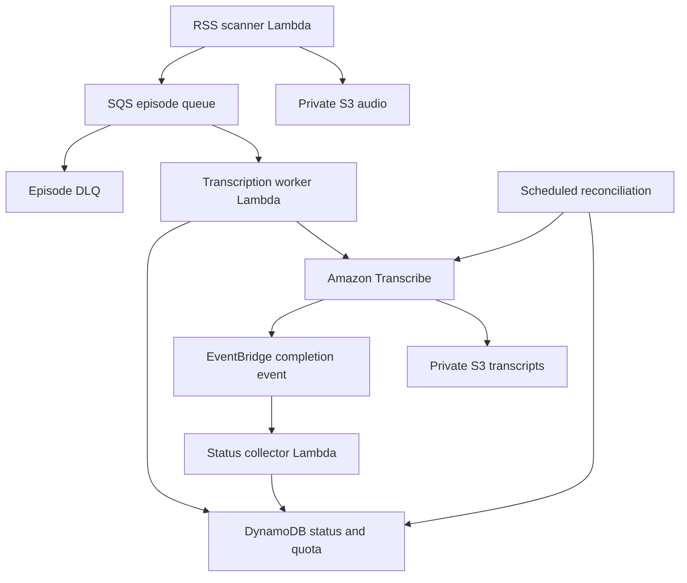

# PodcastLens

A Python/AWS application for RSS discovery,
SQS processing, asynchronous Amazon Transcribe jobs, S3 transcripts, DynamoDB
episode status, dead-letter queues, CloudWatch alarms, a monthly transcription
admission quota, and repeatable CloudFormation infrastructure.

**Begin with the [deployment walkthrough](docs/START_HERE.md).** Run all commands
in this document from the repository's `backend/` directory.

This is the backend deployed as `podcast-lense-dev` in `us-east-1` on November 8,
2026. Its original pipeline code, CloudFormation template and deployment script
match the tested archive. A new `api.py` connects the preserved frontend to these
resources through a companion web stack. See the [root guide](../README.md) and
[validation record](docs/VALIDATION.md). Live dashboard deployment is pending.

## Flow



An authenticated CLI can also upload a short recording directly, read status,
and perform bounded literal transcript search. The companion dashboard adds an
authenticated operator API and website using these same records and transcripts.

## Files and responsibilities

| File | Responsibility |
|---|---|
| `src/podcastlens/feeds.py` | RSS parsing, bounded/pinned HTTPS fetches, ingest/outbox |
| `src/podcastlens/worker.py` | SQS partial responses and idempotent job submission |
| `src/podcastlens/store.py` | Conditional status updates and atomic quota reservation |
| `src/podcastlens/status.py` | Completion events and paginated reconciliation |
| `src/podcastlens/core.py` | Audio inspection, identity, logs/metrics, literal search |
| `src/podcastlens/api.py` | Authenticated dashboard routes using existing data and scanner |
| `template.json` | Plain CloudFormation, IAM roles, queues, alarms and event rules |
| `scripts/deploy.sh` | Build/package and deploy using AWS CLI |
| `cli.py` | Personal operator commands using your existing AWS credentials |
| `tests/` | Unit and mocked AWS integration tests; no cloud resources required |
| `../.github/workflows/test.yml` | Separate backend and web-app CI checks; no auto-deploy |

## Run the tests locally

Python 3.12 is the deployed runtime. Python 3.11+ also runs the local code.

```bash
python3 -m venv .venv
source .venv/bin/activate
python -m pip install -r requirements-dev.txt
python -m pytest -q
cfn-lint template.json
```

On Windows use `.venv\Scripts\Activate.ps1`. Use AWS CloudShell for `deploy.sh`.
There is no AWS credential file in the project.

## Reliability decisions

- Source delivery is at least once. Episode and Transcribe job names are stable.
  A crash after Transcribe accepts a job is recovered by inspecting that same
  job name, rather than allocating a new name.
- Quota reservation and episode reservation are one DynamoDB transaction. This
  prevents a naive read-then-increment race. Retries reuse the recorded month.
  An uncertain external call retains its reservation; the app does not refund
  potentially billable work automatically.
- Ingest writes an `enqueuePending` record before sending SQS. Reconciliation can
  repair an unsent enqueue. A crash after send can duplicate the message, which
  the worker handles idempotently. The S3 write can leave an orphan if metadata
  creation fails; a deterministic key and lifecycle expiration bound that gap.
- The worker reports per-message failures. SQS moves repeatedly failing messages
  into the episode DLQ after five receives. Reconciliation does not endlessly
  resubmit those messages and defeat the DLQ policy.
- Transcribe completion events are best effort. Reconciliation queries the
  service for nonterminal jobs. It persists per-status index cursors to cover
  later pages. This is eventual repair, not an instantaneous consistency promise.
- EventBridge target failures and Lambda asynchronous handler failures use the
  operations DLQ. That queue is distinct from the SQS worker's episode DLQ.
- Terminal states cannot be overwritten by late PROCESSING events.

## Security and scope

Private S3 buckets block public access and deny non-TLS requests. IAM runtime roles
are separated by function. Transcribe receives a narrowly scoped data role.
The CLI is an administrative tool for a single trusted account, not a tenant API.
Feed URLs are operator configured; HTTPS hosts are explicitly allowed, DNS results
must be public, connections pin a checked address, and redirects are revalidated.
XML entity expansion, large downloads and excessive durations are rejected.

The pipeline is not a sandbox for adversarial media. Parser estimates and a
monthly admission quota do not guarantee a maximum invoice. Source quality,
actual transcription accuracy and cloud behavior require acceptance checks in
the target account. The validation record distinguishes completed checks from
remaining RSS, quota-boundary, recovery and DLQ exercises.

## Supported and deferred

Implemented: RSS 2.0, up to five configured feeds, recent-item discovery, short
WAV/MP3/M4A/FLAC/OGG media, one language per deployment, CLI status and literal
search, operational controls above. A scan attempts up to three new episodes.

Implemented but pending live validation: the authenticated frontend integration.
Deferred: the proposed C# API extension,
multi-user authorization, full-text search index, long recordings, large archive
backfills, deployment OIDC, load/soak tests, disaster recovery and production SLOs.

## Reading

- [Transcribe start API](https://docs.aws.amazon.com/transcribe/latest/APIReference/API_StartTranscriptionJob.html)
- [Transcribe events](https://docs.aws.amazon.com/transcribe/latest/dg/monitoring-events.html)
- [Lambda + SQS configuration](https://docs.aws.amazon.com/lambda/latest/dg/services-sqs-configure.html)
- [SQS partial batch failures](https://docs.aws.amazon.com/lambda/latest/dg/services-sqs-errorhandling.html)
- [DynamoDB transactions](https://docs.aws.amazon.com/amazondynamodb/latest/developerguide/transaction-apis.html)
- [Transcribe IAM](https://docs.aws.amazon.com/transcribe/latest/dg/security_iam_id-based-policy-examples.html)
- [Transcribe pricing](https://aws.amazon.com/transcribe/pricing/)
- [AWS Budgets](https://docs.aws.amazon.com/cost-management/latest/userguide/budgets-managing-costs.html)

Built November 8, 2026. See `docs/VALIDATION.md` for what was actually checked.
